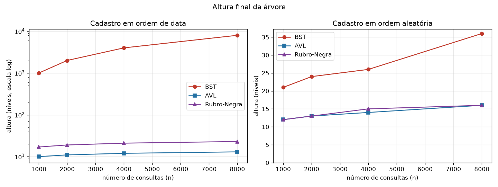
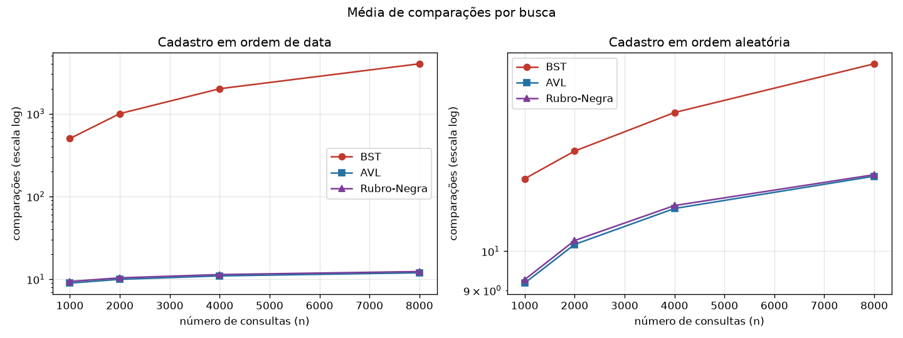
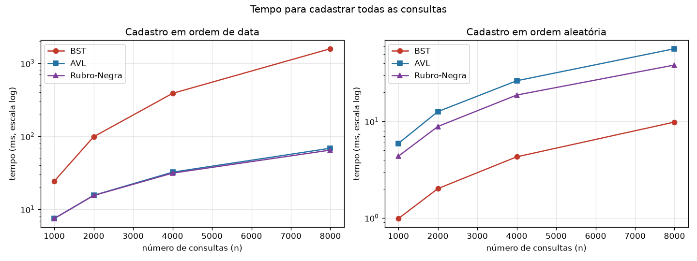
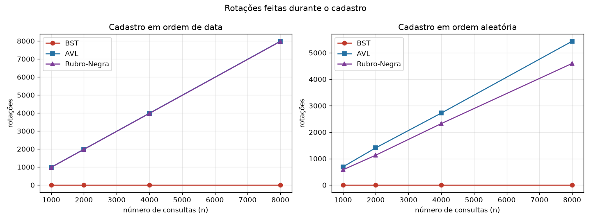
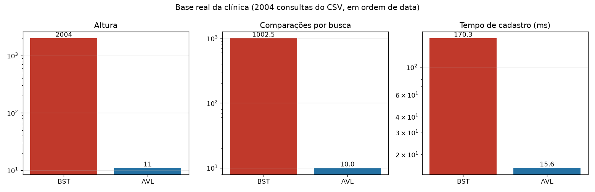

# G28_Arvores_EDA2-2026.2

Comparação entre **BST**, **AVL** e **Árvore Rubro-Negra** aplicadas à agenda de consultas de uma clínica.

| 8.000 consultas cadastradas em ordem de data | BST | AVL | Rubro-Negra |
|---|---:|---:|---:|
| Altura da árvore | 8.000 níveis | 13 níveis | 23 níveis |
| Comparações para achar uma consulta (média) | 4.000,5 | 11,98 | 12,39 |
| Tempo para cadastrar tudo | 1.583,9 ms | 68,8 ms | 64,8 ms |

A BST vira uma lista: para achar uma consulta ela compara, em média, com metade das 8.000 (por isso 4.000,5 = (8.000 + 1) / 2). AVL e Rubro-Negra se reequilibram sozinhas e acham qualquer consulta em cerca de 12 comparações.

## Cenário

Cada médico tem uma árvore com chave = **data e hora da consulta**. Assim ninguém marca dois pacientes no mesmo horário com o mesmo médico.

Escolhemos esse contexto porque consultas são cadastradas **em ordem cronológica**. Chaves chegando ordenadas são o pior caso da BST (ela vira uma lista encadeada), e é exatamente isso que a AVL e a Rubro-Negra resolvem.

| No dia a dia | Na árvore |
|---|---|
| Esse horário está livre? | busca |
| Marcar uma consulta | inserção |
| Cancelar uma consulta | remoção |
| Próxima consulta / próximo horário livre | sucessor |
| Agenda do dia ou da semana | busca por intervalo |

**Objetivo:** implementar as três árvores, aplicá-las nessa agenda, mostrar o funcionamento passo a passo e comparar altura, comparações, rotações e tempo.

## Base de dados

[`dados/consultas_clinica.csv`](dados/consultas_clinica.csv): **2.004 consultas simuladas** de 3 médicos, 12 semanas de dias úteis a partir de 16/11/2026, horários de 30 em 30 min (08:00-11:30 e 14:00-17:30), cerca de 70% de ocupação, linhas em ordem cronológica. Campos: `id, data_hora, medico, paciente, tipo, status` (1.764 agendadas, 240 canceladas). Gerada por [`dados/gerar_base.py`](dados/gerar_base.py) com seed 42: rodar de novo gera o mesmo arquivo.

## Estrutura e como rodar

```
├── dados/                  # base CSV e gerador
├── src/
│   ├── models.py           # Consulta e leitura do CSV
│   ├── agenda.py           # regras da agenda (uma árvore por médico)
│   ├── cenarios.py         # entradas do benchmark (seed 42)
│   └── arvores/
│       ├── base.py         # comum às três: busca, sucessor, intervalo, altura, desenho
│       ├── bst.py
│       ├── avl.py
│       └── rubro_negra.py
├── main.py                 # demonstração passo a passo
├── testes.py               # testes de corretude
├── comparacao.py           # benchmark -> assets/ultimos_resultados.json
└── plot_results.py         # gráficos -> assets/
```

```bash
pip install -r requirements.txt   # matplotlib, só para os gráficos (Python 3.10+)
python main.py                    # demonstração
python testes.py                  # "Todos os testes passaram."
python comparacao.py              # benchmark (~1 min)
python plot_results.py            # gráficos
```

## BST

[`src/arvores/bst.py`](src/arvores/bst.py) · **Regra:** menores à esquerda, maiores à direita. Busca, inserção e remoção custam O(h), onde h é a altura.

**O problema:** a BST não se reorganiza. Com datas em ordem, cada consulta nova é maior que todas e vai sempre para a direita: a árvore vira uma lista com **h = n**. Com 8.000 consultas, a altura é 8.000. Por isso a BST é toda iterativa: recursiva, estouraria o limite de recursão do Python.

Remoção: folha sai; nó com um filho é trocado pelo filho; nó com dois filhos recebe o sucessor (menor da direita).

## AVL

[`src/arvores/avl.py`](src/arvores/avl.py) · **Regra:** em todo nó, `altura(esquerda) - altura(direita)` fica entre -1 e +1. Isso garante altura de no máximo ~1,44 · log2(n), então tudo custa O(log n).

Depois de inserir ou remover, cada nó do caminho recalcula a altura. Se o fator chegar a +2 ou -2, rotaciona:

| Caso | Correção |
|---|---|
| esquerda-esquerda | rotação à direita |
| direita-direita | rotação à esquerda |
| esquerda-direita | esquerda no filho, depois direita |
| direita-esquerda | direita no filho, depois esquerda |

Na agenda as datas chegam em ordem, então cai sempre no caso **direita-direita**. A demonstração mostra cada rotação acontecendo:

```
  inserir 16/11 09:00
    [AVL] caso direita-direita em 16/11 08:00
    [AVL] rotação à esquerda em 16/11 08:00 (16/11 08:30 sobe)
```

Na inserção, basta uma correção (1 ou 2 rotações) no nó desequilibrado mais baixo: a subárvore volta à altura de antes e o resto do caminho fica equilibrado. Na remoção, corrigir um nó pode desequilibrar o de cima, então a correção pode subir até a raiz.

## Rubro-Negra

[`src/arvores/rubro_negra.py`](src/arvores/rubro_negra.py) · **Regras:** cada nó é vermelho ou preto; a raiz e as folhas vazias (sentinela NIL) são pretas; vermelho não tem filho vermelho; todo caminho até uma folha tem a mesma quantidade de pretos. Isso limita a altura a 2 · log2(n + 1).

Na inserção, tio vermelho se resolve **recolorindo**; tio preto, com **rotação** (no máximo 2). Na remoção, a correção do "duplo preto" ajusta irmão e sobrinhos (no máximo 3 rotações). O desenho marca cada nó com `[V]` ou `[P]`, e `recoloracoes` conta cada troca de cor.

## Agenda e demonstração

[`src/agenda.py`](src/agenda.py) traduz cada pedido numa operação da árvore: `horario_livre` (busca), `agendar` (inserção; recusa horário ocupado, fim de semana e fora da grade), `cancelar` (remoção), `remarcar`, `proxima_consulta` (sucessor), `agenda_do_dia` e `agenda_da_semana` (intervalo). A mesma agenda roda sobre qualquer uma das três árvores.

`python main.py` mostra, desenhando as árvores no terminal:
1. **BST com 7 consultas em ordem** vira uma escada (altura 7).
2. **AVL e Rubro-Negra** com as mesmas consultas: rotações e recolorações aparecendo uma a uma (AVL termina com altura 3, Rubro-Negra com 4).
3. **Cancelamentos** com rebalanceamento.
4. **Base real**, uma árvore por médico: BST com altura de 585/610/569 níveis (igual ao número de consultas de cada médico), AVL 10 níveis, Rubro-Negra 16 níveis.
5. **A agenda funcionando**: horário livre, agendar, recusa de horário ocupado e de domingo, remarcar, cancelar, agenda da semana.

`python testes.py` roda **23 testes** nas três árvores. Depois das operações, `validar()` confere as regras de cada uma (ordem, fator da AVL, cores da Rubro-Negra) e o conteúdo é comparado com um dicionário.

## Resultados

Mesmas chaves para as três árvores (seed 42), tempos = mediana de 3 execuções (Python 3.15, macOS). **Tempos mudam de máquina para máquina; altura, comparações, rotações e recolorações não.** Dados completos em [`assets/ultimos_resultados.json`](assets/ultimos_resultados.json).

| n = 8.000 consultas | BST | AVL | Rubro-Negra |
|---|---:|---:|---:|
| **Em ordem de data:** altura (níveis) | 8.000 | 13 | 23 |
| comparações por busca (média) | 4.000,5 | 11,98 | 12,39 |
| rotações / recolorações (total) | 0 | 7.987 | 7.977 / 39.882 |
| tempo para cadastrar as 8.000 | 1.583,9 ms | 68,8 ms | 64,8 ms |
| **Em ordem aleatória:** altura (níveis) | 36 | 16 | 16 |
| comparações por busca (média) | 16,55 | 12,23 | 12,28 |
| rotações / recolorações (total) | 0 | 5.436 | 4.598 / 18.388 |
| tempo para cadastrar as 8.000 | 9,8 ms | 56,7 ms | 38,4 ms |
| **Cancelando 4.000 das 8.000:** tempo para cancelar | 621,5 ms | 17,3 ms | 16,6 ms |
| rotações / recolorações (total) | 0 | 652 | 761 / 9.698 |
| altura depois (níveis) | 4.000 | 13 | 14 |

**Como ler:** altura = número de níveis da árvore; comparações = quantas chaves a busca olha, em média, até achar a consulta; rotações e recolorações = total de operações de rebalanceamento feitas na rodada inteira; tempos em milissegundos (ms).

**Base real** (as 2.004 linhas do CSV numa árvore só): altura de 2.004 / 11 / 19 níveis e, em média, 1.002,5 / 9,98 / 10,41 comparações por busca (BST / AVL / Rubro-Negra).

<p>
 
 
 

</p>

**O que os números mostram:**
- **BST:** em ordem de data vira lista (a busca percorre metade da agenda) e cancelar não conserta. Só vai bem com dados aleatórios, e numa agenda eles não são.
- **AVL:** a mais baixa (13, quase o mínimo log2 8.000 = 12,97) e a que menos compara. Paga com quase uma rotação por consulta cadastrada.
- **Rubro-Negra:** mais alta (23, dentro do limite de ~26), quase o mesmo número de comparações. Rotaciona parecido com a AVL, mas recolore bastante (~5 vezes por consulta). Foi a mais rápida para cadastrar, principalmente com dados aleatórios (38,4 contra 56,7 ms).
- AVL e Rubro-Negra cadastram as 8.000 consultas em ordem **23 a 24 vezes mais rápido** que a BST.

## Recomendação para o cliente

**Não usar a BST**: a agenda recebe as consultas em ordem de data, que é o pior caso dela.

**Usar a AVL.** Uma agenda é muito mais consultada do que alterada (recepção e pacientes procuram horários o dia todo), e a AVL é a mais baixa e a que menos compara na busca.

A **Rubro-Negra** também atende bem e seria a escolha num sistema com muito mais escrita do que leitura (muitos cadastros, cancelamentos e remarcações): rebalanceia com regras mais folgadas e foi a mais rápida para cadastrar. É a estrutura usada, por exemplo, no `TreeMap` do Java.

## Integrantes

- Enzo Lopes ([@lopes061](https://github.com/lopes061))
- Luan Vinícius ([@luannvi](https://github.com/luannvi))

## Vídeo de Apresentação

[](https://www.youtube.com/watch?v=lD3ITQ7PZws)
