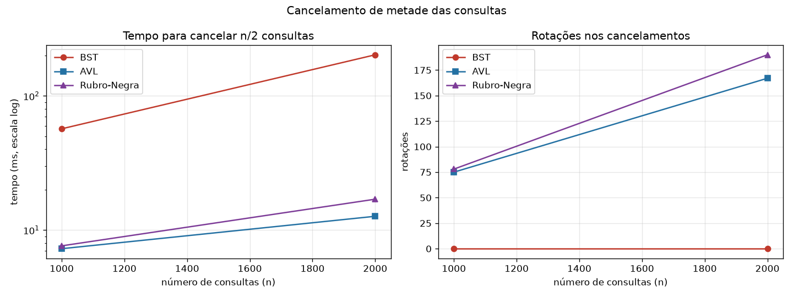
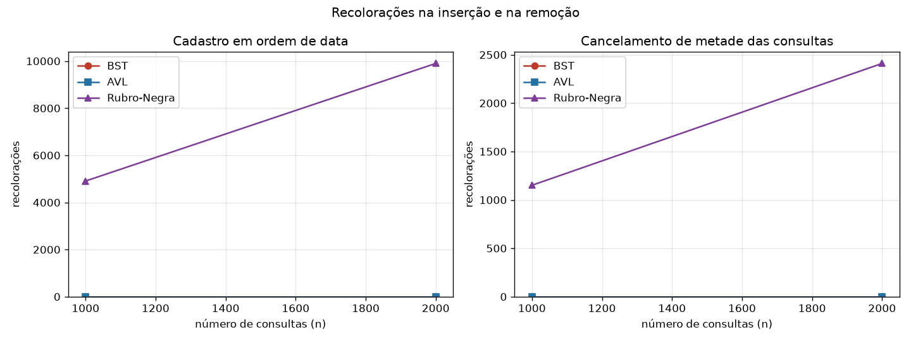

# G28_Arvores_EDA2-2026.2

Comparação entre **BST**, **AVL** e **Árvore Rubro-Negra** aplicadas a um sistema de agendamento de consultas de uma clínica.

## Cenário

Toda clínica, consultório ou salão precisa de uma agenda: dado um dia e horário, saber se está livre, qual é a próxima consulta e o que há marcado na semana. Neste trabalho cada médico tem uma agenda indexada por **data e horário** (a chave da árvore), de modo que dois pacientes nunca ocupam o mesmo horário com o mesmo médico.

**Por que esse contexto para este trabalho?**

No trabalho anterior (Ordenação) usamos o estoque de uma farmácia. Agora escolhemos um contexto diferente de propósito: consultas são marcadas, em grande parte, **em ordem cronológica**, e chaves que chegam ordenadas são o pior caso de uma BST comum (ela degenera em uma lista encadeada). É exatamente o problema que a AVL e a Rubro-Negra resolvem, então esse contexto deixa a diferença entre as três estruturas evidente.

Operações que a agenda precisa suportar:

| Operação no dia a dia | Operação na árvore |
|---|---|
| Esse horário está livre? | busca |
| Marcar uma consulta | inserção |
| Cancelar uma consulta | remoção (rebalanceamento) |
| Qual o próximo horário disponível? | sucessor |
| O que há marcado nesta semana? | busca por intervalo |

## Objetivos

**MVP**
- Implementar BST, AVL e Rubro-Negra (inserção, busca e remoção).
- Medir altura final, número de rotações, comparações por busca e tempos de execução.
- Aplicar a estrutura numa agenda real (horário livre, próximo horário livre, agenda do dia/semana).

**Extras (planejados)**
- Desenho da árvore no terminal com as rotações aparecendo passo a passo.
- Testes automáticos que validam as regras de cada árvore após cada operação.
- Gráficos comparativos e recomendação para o cliente.

## Tecnologias

- Python 3.10+
- matplotlib (gráficos do benchmark; instalar com `pip install -r requirements.txt`)

## Base de dados

A base é **simulada**, gerada por script com semente fixa (seed 42), então qualquer integrante gera exatamente o mesmo arquivo.

- Arquivo: [`dados/consultas_clinica.csv`](dados/consultas_clinica.csv)
- Gerador: [`dados/gerar_base.py`](dados/gerar_base.py)

| Característica | Valor |
|---|---|
| Consultas | 2.004 |
| Médicos | 3 (Dra. Marina Souza, Dr. Paulo Lima, Dra. Renata Alves) |
| Período | 16/11/2026 a 05/02/2027 (12 semanas de dias úteis) |
| Horários | de 30 em 30 minutos, 08:00-11:30 e 14:00-17:30 |
| Ocupação simulada | cerca de 70% dos horários |
| Ordem das linhas | cronológica (como as consultas são cadastradas no dia a dia) |

Campos:

| Campo | Descrição |
|---|---|
| `id` | identificador da linha |
| `data_hora` | data e horário da consulta (**chave da árvore**), formato `AAAA-MM-DD HH:MM` |
| `medico` | médico responsável (uma árvore por médico) |
| `paciente` | nome do paciente |
| `tipo` | `consulta`, `retorno` ou `exame` |
| `status` | `agendada` ou `cancelada` |

Regra de integridade: para o mesmo médico, não existem duas consultas com a mesma `data_hora`.

## Estrutura

Estrutura atual do repositório:

```
├── dados/
│   ├── consultas_clinica.csv   # base de dados simulada
│   └── gerar_base.py           # gerador (seed 42)
├── assets/                     # resultados JSON e gráficos do benchmark
├── src/
│   ├── models.py               # Consulta, carregar_consultas(), gerar_horarios()
│   ├── agenda.py               # regras de negócio da agenda (uma árvore por médico)
│   ├── cenarios.py             # entradas reproduzíveis do benchmark
│   └── arvores/
│       ├── base.py             # contrato comum: busca, sucessor, intervalo, altura, desenho
│       ├── bst.py              # árvore binária de busca sem balanceamento
│       ├── avl.py              # AVL: rebalanceia com rotações
│       └── rubro_negra.py      # Rubro-Negra: rebalanceia com rotações e cores
├── comparacao.py               # benchmark dos cenários
├── main.py                     # demonstração passo a passo
├── plot_results.py             # gráficos comparativos
├── testes.py                   # testes de corretude
└── README.md
```

## Como rodar

Requer Python 3.10+. Para gerar os gráficos, instale `matplotlib` pelas dependências do projeto.

```bash
python dados/gerar_base.py   # gera de novo a base (sai idêntica, seed 42)
python testes.py             # deve terminar com "Todos os testes passaram."
python -X utf8 main.py       # demonstração passo a passo (UTF-8 no terminal do Windows)
python comparacao.py         # benchmark (1.000, 2.000, 4.000 e 8.000 chaves)
python comparacao.py 500 1000 2000  # tamanhos menores para rodar mais rápido
python plot_results.py       # gera os PNGs em assets/
```

## BST (Árvore Binária de Busca)

Arquivo: [`src/arvores/bst.py`](src/arvores/bst.py)

Regra: para cada nó, tudo na subárvore esquerda tem chave menor e tudo na direita tem chave maior. Na agenda, a chave é a data/hora da consulta.

| Operação | Como funciona | Custo |
|---|---|---|
| Buscar | compara com o nó e desce para a esquerda ou direita | O(h) |
| Inserir | desce como na busca e pendura o novo nó numa folha; se o horário já existe, recusa (horário ocupado) | O(h) |
| Remover | folha: só retira. Um filho: o filho sobe. Dois filhos: copia o sucessor (menor da direita) e remove o sucessor | O(h) |
| Próxima consulta a partir de X | guarda o último nó maior que X no caminho da busca | O(h) |
| Agenda do dia/semana | percurso em ordem que só desce nos ramos dentro do intervalo | O(h + k) |

`h` é a altura da árvore e `k` o número de consultas devolvidas.

**O problema:** a BST não se reorganiza. A forma depende só da ordem em que as chaves chegam. Numa agenda as consultas são cadastradas, em grande parte, em ordem cronológica: cada nova data é maior que todas as anteriores e vai sempre para a direita. A árvore vira uma lista encadeada, com `h = n`. Os testes mostram isso: com 8.000 horários em ordem a altura é 8.000, e buscar a última consulta custa 8.000 comparações. Com os mesmos horários embaralhados a altura fica abaixo de 60.

Por isso todas as operações da BST são **iterativas**: uma versão recursiva estouraria o limite de recursão do Python nessa árvore degenerada.

O que é comum às três árvores (busca, sucessor, intervalo, altura, desenho no terminal e contadores de comparações e rotações) fica em [`src/arvores/base.py`](src/arvores/base.py). Cada árvore implementa só `inserir`, `remover` e `validar`.

### Testes

[`testes.py`](testes.py) chama `validar()` (na maioria dos testes, depois de cada operação) e, no fim de cada teste, compara a árvore com um dicionário. O `validar()` confere a ordem das chaves, o tamanho e, na BST, os ponteiros de pai. Cobre árvore vazia, inserção em ordem e aleatória, horário ocupado, os três casos de remoção, 3.000 operações misturadas, sucessor, intervalo, desenho e a carga da base real (uma árvore por médico).

## AVL

Arquivo: [`src/arvores/avl.py`](src/arvores/avl.py)

A AVL é uma BST que se rebalanceia sozinha. Cada nó guarda a própria altura, e o **fator de balanceamento** é `altura(esquerda) - altura(direita)`. A regra é: em todo nó o fator fica entre -1 e +1. Isso garante altura de no máximo cerca de `1,44 · log2(n)`, então busca, inserção e remoção custam O(log n) sempre, mesmo com as datas chegando em ordem.

Inserção e remoção descem como na BST. Na volta da recursão, cada nó do caminho recalcula a altura e, se o fator virou +2 ou -2, aplica a rotação do caso:

| Caso | Fator do nó | Fator do filho | Correção |
|---|---|---|---|
| esquerda-esquerda | +2 | >= 0 | rotação à direita |
| esquerda-direita | +2 | < 0 | rotação à esquerda no filho, depois à direita |
| direita-direita | -2 | <= 0 | rotação à esquerda |
| direita-esquerda | -2 | > 0 | rotação à direita no filho, depois à esquerda |

Rotação à esquerda em `x` (caso direita-direita):

```
  x                 y
   \               / \
    y      ->      x   z
     \
      z
```

Na agenda, as consultas entram em ordem cronológica. Cada nova consulta pende a árvore para a direita, e a AVL corrige com rotações à esquerda. Com `verbose=True` a árvore imprime cada caso e cada rotação. Inserindo 10, 20 e 30, em ordem:

```
    [AVL] caso direita-direita em 10
    [AVL] rotação à esquerda em 10 (20 sobe)
```

O desenho mostra o fator de cada nó:

```
    ┌── 30 [f=+0]
┌── 28 [f=+0]
│   └── 25 [f=+0]
20 [f=-1]
└── 10 [f=+0]
```

Como a altura é O(log n), a AVL pode ser recursiva sem risco de estourar a pilha. Na remoção de um nó com dois filhos, ela copia o sucessor (como a BST) e rebalanceia todo o caminho até a raiz. A diferença está em quantos nós precisam ser corrigidos: na inserção, no máximo um nó se desequilibra (1 rotação simples ou 2 numa dupla) e o resto do caminho volta ao normal. Na remoção, corrigir um nó pode desequilibrar o de cima, então podem ser necessárias rotações em vários nós até a raiz, O(log n) no pior caso.

**Primeiro resultado (testes):** com os mesmos 8.000 horários em ordem que deixam a BST com altura 8.000, a AVL fica com altura 13 e faz em média 12 comparações por busca (11,98), contra 4.000,5 da BST. O preço é rotacionar: foram 7.987 rotações para montar a árvore.

### Testes da AVL

Além dos testes comuns das árvores, [`testes.py`](testes.py) confere:
- os quatro casos de rotação, com 3 chaves cada (1 rotação nos casos simples, 2 nos duplos);
- a altura com 8.000 datas em ordem dentro do limite teórico;
- o rebalanceamento depois de cancelar metade das consultas;
- a saída do modo `verbose`.

O `validar()` da AVL refaz a altura de cada nó a partir das folhas e confere se a altura guardada está certa e se o fator está entre -1 e +1.

## Árvore Rubro-Negra

Arquivo: [`src/arvores/rubro_negra.py`](src/arvores/rubro_negra.py)

A Rubro-Negra é uma BST balanceada que guarda uma cor (vermelho ou preto) em cada nó. A implementação usa um nó sentinela preto para representar folhas vazias e manter a inserção e a remoção iterativas. As regras são:

- a raiz e todas as folhas vazias são pretas;
- um nó vermelho não pode ter filho vermelho;
- todo caminho de um nó até uma folha vazia contém a mesma quantidade de nós pretos.

Essas regras limitam a altura a `2 · log2(n + 1)`. Busca, inserção e remoção ficam em O(log n) no pior caso. Na inserção, o algoritmo corrige os casos de tio vermelho com recolorações e os casos internos/externos com rotações. Na remoção, a correção propaga o nó duplamente preto para cima ou ajusta irmão e sobrinhos; os mesmos casos são espelhados para os dois lados. Uma inserção usa no máximo duas rotações e uma remoção, no máximo três.

Com `verbose=True`, a árvore imprime os casos, rotações e mudanças de cor. O desenho marca cada nó com `[V]` (vermelho) ou `[P]` (preto). Além dos contadores comuns, `recoloracoes` conta cada mudança efetiva de cor; `zerar_contadores()` reinicia os três contadores.

### Testes da Rubro-Negra

[`testes.py`](testes.py) verifica os casos espelhados de inserção, recoloração por tio vermelho, altura com 8.000 datas em ordem, desenho e saída `verbose`. Também executa 3.000 operações aleatórias e confere, após cada uma, as cores, a altura preta, os ponteiros dos pais e o conteúdo contra um dicionário. Os testes comuns de busca, remoção, sucessor, intervalo, agenda e base real rodam nas três árvores.

## Agenda da clínica e demonstração

Arquivo: [`src/agenda.py`](src/agenda.py)

A classe `Agenda` guarda uma árvore por médico e traduz cada pedido do dia a dia numa operação da árvore. A estrutura é escolhida na criação (`Agenda(BST)`, `Agenda(AVL)` ou `Agenda(RubroNegra)`), então o mesmo código de negócio roda sobre as três. `Agenda.da_base()` carrega as consultas agendadas de [`dados/consultas_clinica.csv`](dados/consultas_clinica.csv).

| Método | O que responde | Operação na árvore |
|---|---|---|
| `horario_livre(medico, data_hora)` | esse horário está livre? | busca |
| `agendar(consulta)` | marca a consulta; recusa horário ocupado, fim de semana ou fora da grade | inserção |
| `cancelar(medico, data_hora)` | desmarca e devolve a consulta | busca + remoção |
| `remarcar(medico, de, para)` | muda o horário, se o novo estiver livre | remoção + inserção |
| `proxima_consulta(medico, a_partir_de)` | qual a próxima consulta marcada? | sucessor |
| `proximo_horario_livre(medico, a_partir_de)` | qual o próximo horário vago? | busca horário a horário da grade |
| `agenda_do_dia` / `agenda_da_semana` | o que há marcado no dia/semana | busca por intervalo |

### Demonstração (`python main.py`)

O [`main.py`](main.py) mostra o funcionamento em 5 partes, desenhando as árvores no terminal:

1. **BST com consultas em ordem:** as 7 consultas da manhã entram em ordem e a BST vira uma lista (altura 7).
2. **Árvores balanceadas:** AVL e Rubro-Negra recebem as mesmas consultas; cada rotação e recoloração aparece no momento em que acontece.
3. **Cancelamentos:** remoção com rebalanceamento.
4. **Base real:** as 1.764 consultas agendadas do CSV, uma árvore por médico. Na BST cada médico fica com altura igual ao número de consultas (585, 610 e 569); a AVL fica com altura 10 e a Rubro-Negra, 16.
5. **A agenda funcionando sobre a Rubro-Negra:** agenda do dia, horário livre, próximo horário livre, agendar (e a recusa de horário ocupado e de domingo), próxima consulta, remarcar, cancelar e agenda da semana.

Trecho da saída:

```
--- AVL: inserindo em ordem, rotação por rotação ---
  inserir 16/11 08:00
  inserir 16/11 08:30
  inserir 16/11 09:00
    [AVL] caso direita-direita em 16/11 08:00
    [AVL] rotação à esquerda em 16/11 08:00 (16/11 08:30 sobe)
  ...

    ┌── 16/11 11:00 [f=+0]
┌── 16/11 10:30 [f=+0]
│   └── 16/11 10:00 [f=+0]
16/11 09:30 [f=+0]
│   ┌── 16/11 09:00 [f=+0]
└── 16/11 08:30 [f=+0]
    └── 16/11 08:00 [f=+0]

AVL: 7 consultas, altura 3, 4 rotações
```

Os testes da agenda (em [`testes.py`](testes.py)) conferem as regras de negócio em todas as árvores: horário ocupado, outro médico no mesmo horário, fim de semana, horário fora da grade, remarcar, cancelar duas vezes e a agenda do dia e da semana da base real contra o CSV.

## Benchmark, gráficos e análise experimental

O [`comparacao.py`](comparacao.py) compara as três árvores nos cenários cronológico, aleatório, cancelamento de metade das consultas e base real. Usa as mesmas chaves geradas com semente 42, valida a árvore ao fim de cada rodada e mede altura, comparações por busca, rotações, recolorações da Rubro-Negra e tempo. Cada tempo é a mediana de três execuções. Para reproduzir:

```bash
python comparacao.py
python plot_results.py
```

Os gráficos e os dados da execução ficam em [`assets/`](assets/). No cenário cronológico com 8.000 consultas, a BST degrada para altura 8.000 e a busca média usa 4.000,5 comparações. AVL e Rubro-Negra mantêm a altura abaixo de 24 e a busca perto de 12 comparações:

| Árvore | Altura | Comparações por busca | Inserção (ms) | Rotações na inserção | Recolorações |
|---|---:|---:|---:|---:|---:|
| BST | 8.000 | 4.000,500 | 8.725,1 | 0 | — |
| AVL | 13 | 11,978 | 252,1 | 7.987 | — |
| Rubro-Negra | 23 | 12,395 | 246,1 | 7.977 | 39.882 |

Na entrada aleatória de 8.000 chaves, a BST ficou com altura 36 e foi mais rápida para inserir (53 ms), mas a AVL e a Rubro-Negra ficaram com altura 16 e cerca de 12,2 comparações por busca. Esse resultado mostra que a BST pode ser eficiente quando a ordem é favorável, mas não oferece o limite de altura garantido pelas árvores balanceadas.

Ao cancelar 4.000 das 8.000 consultas cronológicas, a BST levou 3.228 ms e terminou com altura 4.000. AVL e Rubro-Negra levaram cerca de 69 ms e terminaram com altura 13 e 14, respectivamente. A remoção fez 652 rotações na AVL e 761 na Rubro-Negra; a Rubro-Negra também fez 9.698 recolorações durante os cancelamentos.

Na base real, o CSV tem 2.004 linhas, das quais 1.764 estão agendadas. Inserindo todas as linhas e removendo as 240 canceladas, a altura final foi 1.764 na BST, 11 na AVL e 12 na Rubro-Negra. A execução completa foi medida no Python 3.14.7 em Windows AMD64; tempos mudam conforme a máquina, enquanto alturas, comparações, rotações e recolorações são reproduzíveis com a mesma semente.

**Recomendação para a clínica:** usar AVL quando a prioridade for ter a menor altura e o menor número de comparações em buscas. No caso cronológico com 8.000 consultas, ela ficou com altura 13 e 11,98 comparações médias, abaixo dos 23 níveis e 12,40 comparações da Rubro-Negra. A Rubro-Negra também é uma opção adequada: garante O(log n), teve tempo de inserção semelhante e exigiu dez rotações a menos nesse cenário. A BST só é recomendável se a entrada for pequena ou tiver ordem aleatória conhecida; o cadastro cronológico pode fazê-la degradar para O(n).






## Status do projeto

- [x] Escolher o contexto (agenda de clínica) e justificar a escolha
- [x] Definir o modelo de dados e as operações da agenda
- [x] Gerar a base de dados simulada
- [x] Implementar a BST
- [x] Implementar a AVL
- [x] Implementar a Rubro-Negra
- [x] Agenda da clínica e demonstração passo a passo
- [x] Testes de corretude nas três árvores
- [x] Benchmark, gráficos e análise experimental
- [x] Recomendação para o cliente
- [ ] Vídeo de apresentação

## Integrantes

- Enzo Lopes ([@lopes061](https://github.com/lopes061))
- Luan Vinícius ([@luannvi](https://github.com/luannvi))

## Vídeo de Apresentação

(link do vídeo)
